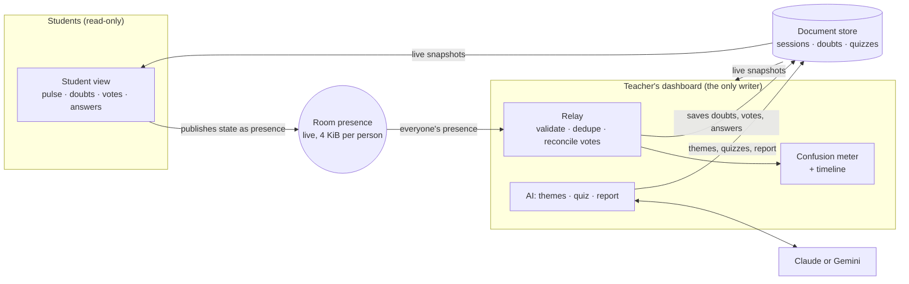
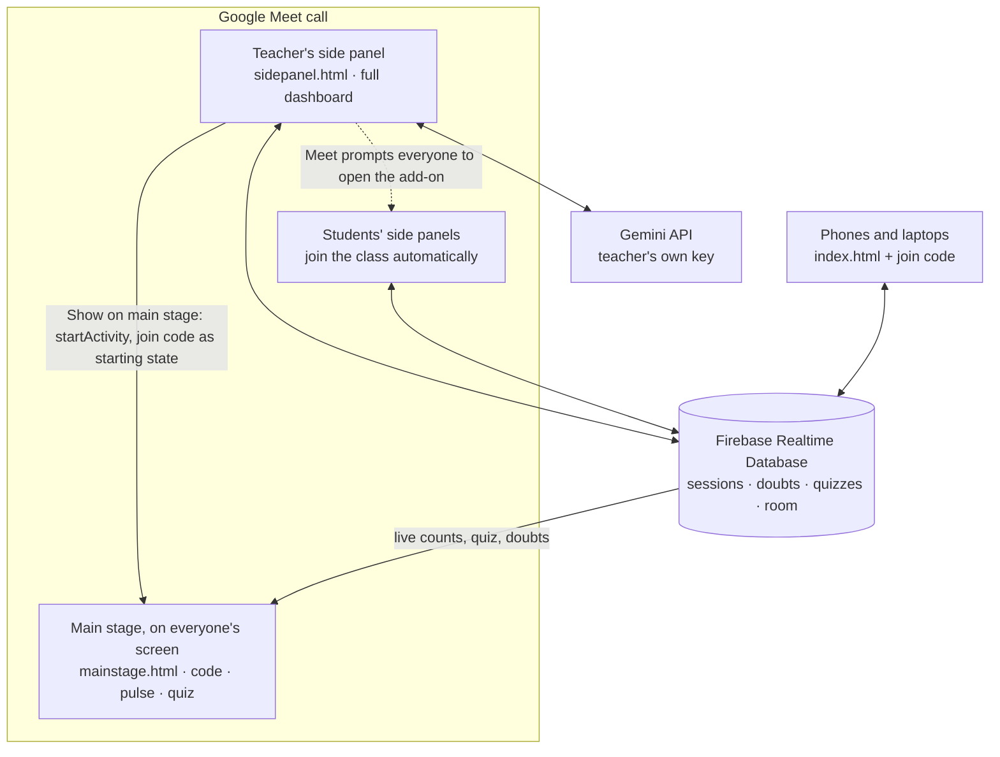

# ClassPulse

**Live classroom feedback with AI, in the lecture hall or on Google Meet.** Students tap how well they're following and send doubts from their phones, and no names are shown. The teacher's dashboard shows a live confusion meter, uses AI to group the doubts into themes, sends a 3-question quick check to every student, and writes an end-of-class report.

| Version | Where to find it |
|---|---|
| **Live app** (Claude version, hosted on claude.ai) | https://claude.ai/artifact/WFcfRndg9w6FtYbkUGiwMa |
| **Google Meet add-on** (runs in the call's side panel and main stage; you host it for free on GitHub Pages with Firebase and Gemini) | `meet-addon/`, with step-by-step instructions in `meet-addon/SETUP.md` |
| **Offline demo** (no accounts and no internet needed) | open `claude-version/index.html` in Chrome or Edge |

---

## Abstract

In a lecture of 60 students, whether in a hall or on a video call, the teacher rarely knows who is lost until the exam. Students hesitate to ask in front of everyone, and the doubts that do get asked are scattered and repetitive.

ClassPulse gives every student an anonymous, one-tap way to signal "Got it", "Unsure" or "Lost", and to send written doubts during the lecture. It then:

- combines the signals into a live confusion index;
- uses a large language model to group the doubts into a few themes, each with a suggested re-explanation;
- generates a short multiple-choice check aimed at those themes;
- produces a report with next steps and practice questions when the class ends.

For online classes, ClassPulse works alongside Google Meet in two ways:

- **Claude version:** a floating meter and a presenter view.
- **Meet add-on:** runs inside the call's side panel and main stage.

Everything runs in the browser with real-time sync, so the teacher can react without stopping the lecture.

---

## Features

**Teacher dashboard**
- **Start a class.** Enter a class name, a topic, optional notes for the AI and an optional Google Meet link. You get a 6-character join code.
- **KPI strip:** students online, confusion index, open doubts and quick-check answers.
- **Confusion meter:** a live **confusion index** (0–100) on a gauge, with a Got it / Unsure / Lost breakdown and a confusion-over-time chart (with a table view).
- **Doubts wall:** filter and sort by "me too" votes or by time, and mark doubts as answered.
- **AI themes:** groups doubts into up to 5 themes. Themes are ranked by how many students they affect, and each one comes with the likely misconception and a "Try this" re-explanation.
- **AI quick check:** 3 multiple-choice questions aimed at the current confusion. Preview them, send them, watch answers arrive, then reveal.
- **Projector-safe:** quiz results and the answer key stay hidden until you reveal them.
- **Simulate students:** adds 22 pretend students with AI-written doubts and live signals, for demos and rehearsal.
- **End-of-class report:** stat tiles, a chart, themes, the most-shared doubts, quiz results, an AI summary, a next-class plan and practice questions. Copy it or download it as Markdown.
- **Class history,** with resume, report and delete.
- **Display:** light and dark themes, at every width from phone to projector.

**Student view (phone or laptop)**
- Join with the code. No name is shown to anyone.
- One-tap pulse (Got it / Unsure / Lost). Signals expire after 10 minutes.
- Send doubts, and tap "Me too" on classmates' doubts.
- Answer quick checks on OMR-style bubbles. When the teacher reveals the answers, see which were correct, with explanations.
- A **Join the video call** button when the class has a Meet link.
- After class: the report's headline and practice questions.

**Online classes on Google Meet**

| Feature | Claude version | Meet add-on |
|---|---|---|
| Meet link saved with the class, and a "Join the video call" button for students | Yes | Not needed (everyone is already in the call) |
| **Pop-out meter:** a small live meter that floats above the Meet window (Picture-in-Picture) | Yes | No |
| **Presenter view** to share in the call (join code, live gauge, quiz results; full screen) | Yes | No (the main stage does this) |
| Full dashboard in Meet's **side panel** | No | Yes |
| **Show on main stage:** join code, live pulse and quiz results on everyone's screen | No | Yes |
| Participants who open the add-on join the class without typing the code | No | Yes |

---

## One app, two platforms

Both versions run the same app file, `claude-version/classpulse-artifact.html`. The app reaches its platform only through one small interface, `window.claude.use(name)`:

| Capability | What the app uses it for | Claude version | Meet add-on version (`runtime-firebase.js`) |
|---|---|---|---|
| `db` | documents, collections and live snapshots | Claude artifact database | Firebase Realtime Database |
| `room` | live presence | Claude artifact live room | Firebase Realtime Database (`room/…`, entries removed when a tab disconnects) |
| `sample` | AI calls that return JSON | Claude, on the teacher's account | Google Gemini, on the teacher's own API key |
| `user` | anonymous ids | Claude account id | Firebase anonymous sign-in |
| `downloads` | saving the report | artifact downloads | browser download |

How each version provides that interface:

- **On claude.ai,** the platform provides `window.claude`.
- **In the Meet build,** `runtime-firebase.js` provides an object with the same methods. It also adds the Meet bridge (side panel, main stage and starting the activity) and the AI settings dialog.
- **With neither,** the app falls back to a built-in local runtime that uses browser storage. That is the offline demo.

So the relay, the confusion index, the AI prompts and the validation are written once and shared by every version.

---

## Tech stack

| Layer | Claude version | Meet add-on version |
|---|---|---|
| Front end | HTML, CSS and vanilla JavaScript in one file, with no framework and no build step | the same file |
| Hosting | Claude artifact on claude.ai | GitHub Pages (free, HTTPS) |
| Database and real time | artifact `db` and `room` capabilities | Firebase Realtime Database and anonymous sign-in (compat SDK 10.12.2), with security rules in `database.rules.json` |
| AI | artifact `sample` capability (Claude) | Gemini API in JSON mode (`gemini-3.8-flash`, with `gemini-3.5-flash-lite` for quick tasks) |
| Meet integration | Meet link, Picture-in-Picture meter, presenter view | Google Meet add-ons SDK 1.1.0 (side panel, main stage, activity starting state) |
| Charts | hand-written SVG and canvas, with no chart library | the same |
| Fonts | Bricolage Grotesque (headings), Figtree (interface), IBM Plex Mono (codes and numbers) | the same |
| Testing | Playwright end-to-end tests with a mocked runtime | Playwright with stand-ins for Firebase, the Meet SDK and Gemini |

---

## Architecture



### Inside a Google Meet call (add-on version)



### Why students never write to the database

On a personal Claude plan, people invited from outside the owner's organization can **read** the artifact's shared data but not **write** it. They can, however, publish **presence** in a live room. So each student's phone publishes its whole state as one presence object:

```json
{ "r": "s", "seat": "k3v6q2rt7wac", "p": "lost", "pt": 1761211234567,
  "q": [{ "i": "a8f3k2m9qz", "t": "Why does it not keep calling itself forever?" }],
  "v": ["b7d2p4x8wn"],
  "a": { "q": "c4n8x2pq", "p": [0, 2, 1] } }
```

- `p` / `pt`: the pulse, and when it was tapped
- `q`: doubts not yet saved (the phone keeps them until they appear in the database)
- `v`: doubts this student said "me too" to
- `a`: submitted quick-check answers

The teacher's dashboard is the single writer. It validates every field, saves new doubts, reconciles votes and records answers. As a result, no student can edit or delete anyone else's data, and the access rule is simply "everyone reads, only editors write".

The Meet build keeps the same design. Its database rules allow three kinds of writes:

- a signed-in browser writes only its own presence entry;
- only the teacher who created a class writes that class's data;
- only the teacher can read their private answer keys.

### Data model

| Claude version path | Meet build path (Firebase) | Contents |
|---|---|---|
| `sessions/{code}` | `col/sessions/{code}` | title, topic, notes, Meet link, host id, status (`live`/`ended`), createdAt, endedAt, active quiz id, latest AI themes, timeline points, seat tokens, simulation count, AI report |
| `sessions/{code}/doubts/{id}` | `sub/{code}/doubts/{id}` | text, author seat token, time, voter seat tokens, vote count, answered flag, simulated flag |
| `sessions/{code}/quizzes/{id}` | `sub/{code}/quizzes/{id}` | questions and options, status (`open`/`revealed`/`closed`), responses by seat, answer key and explanations (only after reveal) |
| `data/users/{teacherId}/qk-{code}-{id}` | `priv/{teacherId}/qk-{code}-{id}` | the quiz answer key, private to the teacher until reveal |
| live room `cp-{code}` | `room/cp-{code}/{entry}` | presence, one entry per open tab |

Access rules:

- **Claude version:** declared at publish as `{ path: "", read: "view", write: "admin" }`.
- **Meet build:** set in `database.rules.json`.

---

## Key algorithms

**Confusion index.** It's computed over the students currently in the room whose signal is under 10 minutes old:

```
index = round(100 × (lost + 0.5 × unsure) / (got + unsure + lost))
```

Ranges are labelled as follows:

| Index | Label |
|---|---|
| 0–24 | Following well |
| 25–49 | Some are unsure |
| 50 or more | Many are lost |

A point is added to the timeline every 15 seconds when the index or the head-count changes, and once a minute regardless.

**Anonymous seats.** Each browser tab gets a random seat id. The dashboard stores only `hash(userId | seatId)` (cyrb53, a 53-bit string hash), never a name. The app never asks for names, so neither the teacher nor other students can see who wrote what.

**Vote reconciliation.** For a student who is present, that student's vote list is the truth. The dashboard adds their seat to every doubt they voted for and removes it from every doubt they didn't. Students who have left keep the votes already saved. Writes happen only when the set of voters actually changes.

**Write queue.** The store is last-writer-wins with no transactions, so all writes go through a queue per document:

- only one write is in flight per document at a time;
- later changes are merged into the pending write;
- a temporary error gets one retry.

Doubt ids are created on the phone, so saving the same doubt twice can never create a duplicate.

**Presence budget.** Presence is capped at 4 KiB per person. A phone keeps at most 5 undelivered doubts (200 characters each), and trims old votes if the object grows past 3,800 bytes.

**Quiz integrity.** The options the AI returns are shuffled before use, because models tend to put the right answer in one position. The answer key stays in the teacher's private storage until the teacher reveals it, so it can't be read from the shared database while the quiz is open.

**Pop-out meter.** A browser's Picture-in-Picture window can only show a video. So the app:

1. draws the meter on a hidden 640×360 canvas;
2. turns the canvas into a live video stream with `canvas.captureStream(4)` (4 frames a second);
3. plays that stream in a muted `<video>`;
4. calls `requestPictureInPicture()`.

The result is an always-on-top window that stays visible over Google Meet and is redrawn whenever the pulse changes.

**Main stage relay.** Simulated students exist only in the teacher's browser. So the dashboard publishes its live counts (got, unsure, lost, online, index) in its own presence, and the main stage displays those. What the class sees always matches the teacher's meter.

**Activity starting state.** **Show on main stage** passes the join code to Meet as the activity's starting state. Every side panel and main stage that opens reads it with `getActivityStartingState()` and goes straight to that class, so nobody types a code inside Meet.

**AI calls.** Every call asks for JSON in a stated shape, and the result is validated field by field:

- ids must match real doubts;
- each question has exactly 4 options;
- the answer index is 0–3.

Failures show a clear message with a retry. Only the teacher's view calls the model:

- **Claude version:** Claude, on the teacher's usage, after a one-time consent prompt.
- **Meet build:** Gemini, on the teacher's own API key. The key is kept only in that browser and sent only to Google's Gemini API.

---

## How to use it

### Claude version: teacher

1. Open the live link while signed in to Claude.
2. Click **Start a class** and fill in the class name, the topic, optional notes for the AI and, for an online class, the Google Meet link.
3. Click **Show code on screen** in the sidebar. Put it on the projector, or share it in the call.
4. Watch the pulse and the doubts. When doubts pile up, click **Find themes**, then **Make a quick check** and **Send to students**.
5. Click **Reveal answers**, then **Close check**.
6. Click **End class** to get the report. Past classes are under **Your classes** on the start page.

### Claude version: giving students access (once)

In Claude, open the artifact's **Share** menu and **invite each student by email**. Students need a Claude account and must be signed in. A public link lets people look at the page but not take part, because the live room only admits signed-in people the owner invited.

### Claude version: student

Open the link, tap **Join a class** and enter the code. Then tap a signal, send doubts and answer checks. If the class has a Meet link, **Join the video call** opens it.

### Claude version: teaching on Google Meet

- **Present in Meet** opens the presenter view, with Join, Pulse and Quiz tabs and a full-screen button. In Meet, click **Share screen** and choose the ClassPulse tab: the class sees the join code, the live gauge and quiz results. Press Esc to close the view.
- **Pop-out meter** floats a small live meter above every window, so you can keep Meet full screen and still watch the class's confusion. It works in Chrome and Edge on a computer. In browsers without Picture-in-Picture, the button is hidden.

### Meet add-on version

`meet-addon/SETUP.md` has every click. In short:

1. **Firebase:** create a project, turn on anonymous sign-in, create a Realtime Database and paste in `database.rules.json`.
2. **Config:** fill in `config.js` with the project's values.
3. **Hosting:** upload the folder to a GitHub repository named `classpulse-meet` and turn on GitHub Pages.
4. **Google Cloud:**
   - enable the Google Workspace Marketplace SDK and the Google Workspace add-ons API;
   - create an HTTP deployment from `addon-manifest.json`;
   - configure it and click **Install**.
5. **In a Meet call:**
   1. Open **Activities** and choose **ClassPulse**.
   2. Open **AI settings** and paste your Gemini key.
   3. Start a class, then click **Show on main stage**.

### Offline demo (no accounts and no internet needed)

1. Open `claude-version/index.html` directly in Chrome or Edge.
2. Start a class in one tab.
3. Open the same file in a second tab and join with the code.

Data stays in that browser. AI features need the live version, but **Simulate students** still works using built-in sample doubts.

---

## Demo script for the viva (5–7 minutes)

**In the hall, with the Claude version**

1. On the laptop connected to the projector, open the live link and start a class: "Data Structures, Lecture 12", topic "Recursion and the call stack", and paste a Meet link.
2. Click **Show code on screen**. Two teammates join from their phones (invite them by email beforehand).
3. The teammates tap **Lost** and **Unsure** and send a doubt each. The meter, the KPIs and the doubts wall update live. One teammate taps **Me too** on the other's doubt.
4. Click **Simulate students** to fill the room with 22 more students and their doubts.
5. Click **Find themes**. Point out the student counts and the "Try this" suggestions.
6. Click **Make a quick check**, show the preview, then click **Send to students**. The teammates answer on their phones. Click **Peek at results**, then **Reveal answers**. The phones show the right and wrong answers.
7. Show the Meet features: open a Meet call, click **Pop-out meter** so the meter floats over it, then open **Present in Meet** and go through its tabs.
8. Click **End class** and walk through the report.

**On Google Meet, with the add-on (after following SETUP.md)**

1. Start a Meet call on the laptop, open **Activities** and choose **ClassPulse**.
2. Start a class in the side panel and click **Show on main stage**. The main stage shows the join code.
3. Teammates join from their phones with the GitHub Pages link and the code. When they tap **Lost**, the gauge on the main stage moves.
4. Click **Simulate students**, then **Find themes**, then send a quick check. The main stage switches to the quiz results. Click **Reveal answers**.
5. Click **End class**. The main stage shows "Class ended" with the report's headline, and the full report opens in the side panel.

Rehearse the day before. Keep the offline demo (`claude-version/index.html`) ready as a backup in case the network fails.

---

## Questions you may be asked

- **Why not let students write to the database directly?** Invited outside viewers are read-only on Claude. A single writer is also simpler and safer: it validates input and stops students tampering with each other's data. Presence is the channel everyone is allowed to use. The Meet build keeps the same design.
- **How is it connected to Google Meet?** At two levels:
  - The Claude version works next to Meet: each class has a Meet link, a Picture-in-Picture meter floats over the call, and a presenter view can be shared.
  - The add-on version uses Google's Meet add-ons SDK. Meet loads `sidepanel.html` in its side panel. **Show on main stage** calls `startActivity()`, which opens `mainstage.html` on the main stage and passes the join code as the activity's starting state.
- **Why a second backend for the add-on?** A Meet add-on must be served from the developer's own website and registered in Google Cloud. The Claude artifact's database, live room and AI only work inside claude.ai. So the add-on build replaces them with Firebase and Gemini behind the same interface, and the app code stays shared.
- **Is the Gemini key safe?** It is never in the code or the repository. The teacher pastes it into **AI settings**, it stays in that browser's storage, and it is sent only to Google's Gemini API. The Firebase values in `config.js` only identify the project; the security rules are what protect the data.
- **What happens if the teacher's screen closes?** Students' phones keep undelivered doubts and keep announcing them in presence. When the dashboard reopens, the relay saves them. Meanwhile, students see "Waiting for your teacher's screen".
- **How do you know it's anonymous?** Only hashed seat tokens are stored, and names are never requested from the platform. The Meet build uses Firebase anonymous sign-in, so it never sees students' Google accounts.
- **How does the AI avoid making things up?** Prompts contain only the class's own data. Outputs must match a strict JSON shape and are validated, and the teacher previews quizzes before sending them. The report says it was written by AI and should be checked.
- **How many students can it handle?**
  - **Claude version:** the room reports up to about 256 participants.
  - **Meet build:** Firebase's free plan allows 100 simultaneous connections (each open tab is one), and the paid plan allows far more.
  - **Both:** a class holds up to 300 doubts.
- **How did you test it?** With three Playwright suites, described below.

---

## Testing

| Suite | Command | What it covers |
|---|---|---|
| Claude version, full class | `node claude-version/test/run.js` | 1 teacher, 2 students with a read-only database and 22 simulated students. Covers joining, signals, doubts, votes, themes, the quiz and reveal, the presenter view, the pop-out meter, the report and history, at desktop and phone widths in light and dark mode. |
| Offline demo | `node claude-version/test/local.js` | the built-in local runtime with two tabs and no `window.claude` |
| Meet add-on | `node meet-addon/test/run-meet.js` | the teacher's side panel, the main stage and a student's side panel, with stand-ins for Firebase, the Meet SDK and Gemini. Covers AI settings (a wrong key, then the right one), auto-join, the live gauge on the main stage, simulation, themes, the quiz and reveal, ending the class and the report. |

You need Node 18 or later and Playwright: run `npm install playwright` and then `npx playwright install chromium`. If you change the app source, run `python3 claude-version/build.py` and `python3 meet-addon/build_meet.py` first.

What the tests don't cover: a real Google Meet call, a real Firebase project or a real Gemini key, because those need your accounts. Rehearse once in a real call before the viva.

---

## Limitations and future work

- **Claude version:** students need Claude accounts and an email invite, and AI calls use the teacher's Claude usage.
- **Meet add-on:** until it's published on the Google Workspace Marketplace, only accounts that installed it can open it inside Meet. Everyone else joins through the website link. Meet add-ons run in Meet on computers, not in the Meet mobile apps.
- **History is per browser:** anonymous ids belong to one browser, so class history from one browser (or from inside Meet) isn't visible in another.
- **One at a time:** one active quick check at a time, and one teacher dashboard per class.
- **Future work:**
  - publish the add-on on the Marketplace;
  - teacher sign-in, so history follows the teacher across devices;
  - co-teachers;
  - trends across a whole course;
  - export to Google Classroom or another LMS;
  - an interface in regional languages.

---

## Project files

```
ClassPulse/
├── README.md                      this document
├── claude-version/
│   ├── classpulse-artifact.html   the app source, exactly as published to claude.ai (shared by both versions)
│   ├── index.html                 the same app as a standalone page (offline demo mode)
│   ├── build.py                   builds index.html from classpulse-artifact.html
│   └── test/                      mock.js (stand-in for Claude's runtime), run.js (full class), local.js (offline)
└── meet-addon/
    ├── SETUP.md                   step-by-step setup: Firebase, GitHub Pages, Google Cloud, Meet
    ├── index.html                 website version (any browser, including phones)
    ├── sidepanel.html             the app inside Meet's side panel
    ├── mainstage.html             Meet's main stage (read-only projector view)
    ├── runtime-firebase.js        Firebase, Gemini and the Meet SDK behind the app's runtime interface
    ├── config.js                  your Firebase and Cloud project values (you fill this in)
    ├── database.rules.json        Realtime Database security rules
    ├── addon-manifest.json        Meet add-on deployment manifest
    ├── logo.png, logo-dark.png    add-on icons
    ├── build_meet.py              rebuilds the three pages from ../claude-version/classpulse-artifact.html
    └── test/                      stand-ins for Firebase and the Meet SDK, and run-meet.js
```
